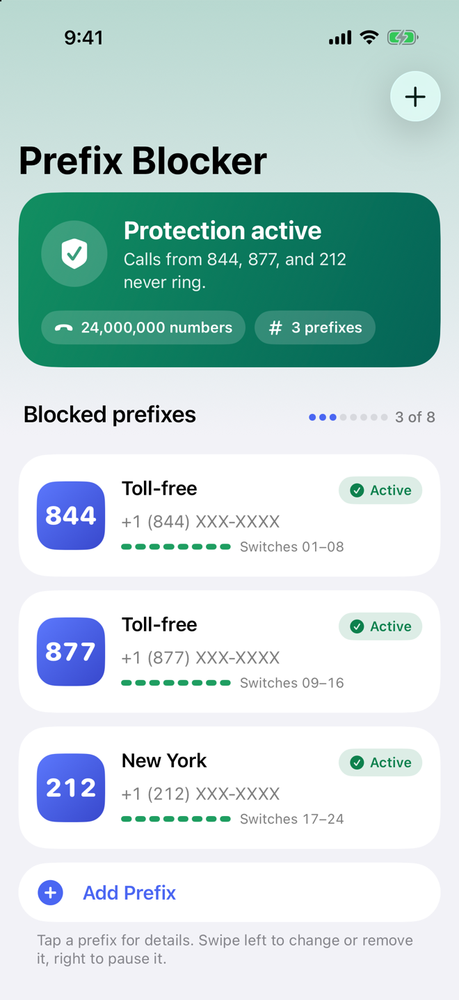
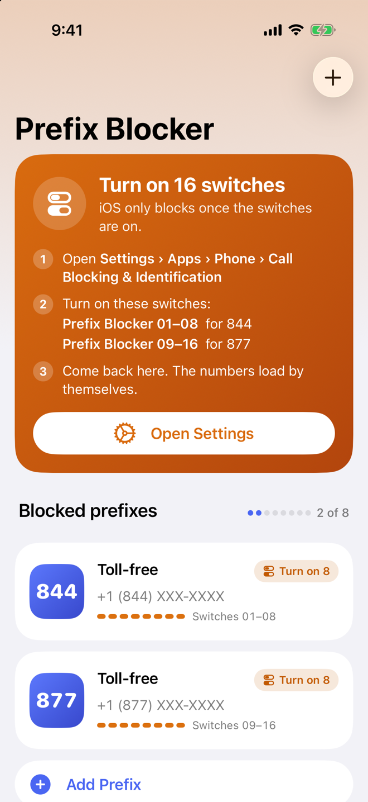
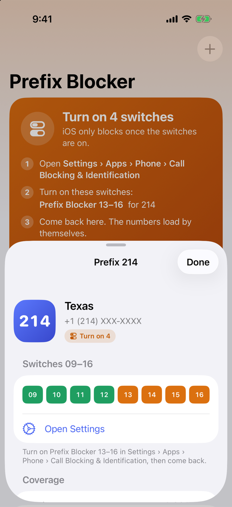
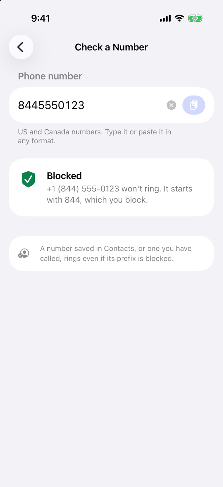
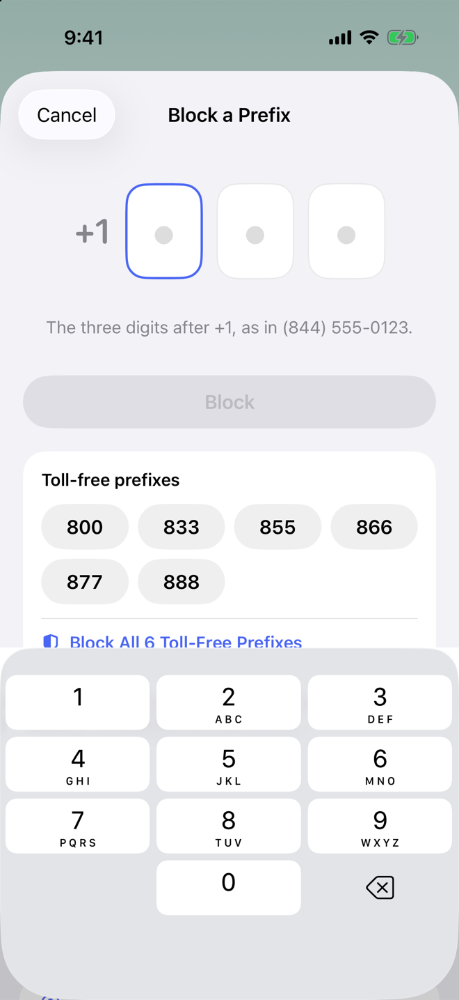
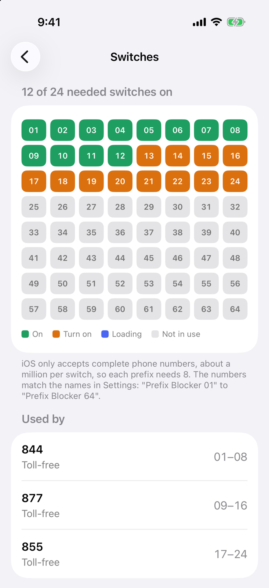
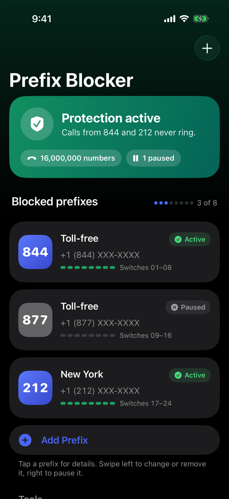

# Prefix Blocker

An iPhone app that silences every call from a 3-digit US or Canada prefix, such as the toll-free prefixes **844** and **877**. It blocks up to 8 prefixes at once, entirely on the device.

<p align="center">
  
  
  
  
</p>

## Features

- **Block by prefix.** Type three digits, or pick a toll-free prefix. One tap adds all seven toll-free prefixes.
- **Change, pause or remove** any prefix. Changing or resuming one reuses the switches it already has, so there is nothing to redo in Settings.
- **Clear status.** The app says whether iOS is really blocking, and names the exact switches to turn on when it isn't.
- **Check a number.** Type or paste a phone number to see whether it is blocked right now.
- **Private.** No account, no network access, no analytics. The app never sees your calls.

## How it works

iOS can't block by pattern. The only on-device mechanism, a CallKit **Call Directory extension**, takes a list of complete phone numbers in ascending order. Blocking `844` therefore means handing iOS every number from `+1 844 200 0000` to `+1 844 999 9999`: 8,000,000 of them (exchanges starting with 0 or 1 don't exist).

One extension can't hold that many. Apple publishes no limit, but developers report a single extension stops accepting entries around 1.8–2 million, and the extension process is killed above about 12 MB of memory. So the app ships **64 identical extensions**, each responsible for exactly **1,000,000 numbers**:

```
prefix 844  →  8 shards of 1,000,000  →  extensions "Prefix Blocker 01" … "08"
prefix 877  →  8 shards of 1,000,000  →  extensions "Prefix Blocker 09" … "16"
```

- **Extensions are stateless.** Whenever iOS runs one, it reads its slot from a small JSON file in the App Group and provides that whole range. A reload started by iOS itself (switch turned on, iOS update, restore) is always complete, with no need to open the app.
- **The app decides who blocks what.** `SlotTable` assigns shards to slots and never moves an existing one, so adding or removing a prefix only reloads the extensions it affects. Changing a prefix swaps its shards in place, and a paused prefix keeps its slots.
- **The app only trusts a successful reload.** `BlockerModel` reloads each extension whose slot changed, one at a time, and counts numbers as blocked only after `reloadExtension` returns without error.

## Building

You need:

- Xcode (built and tested with Xcode 27.2; deployment target iOS 17)
- [XcodeGen](https://github.com/yonaskolb/XcodeGen)
- A paid Apple Developer account. The app needs 65 App IDs and one App Group, more than a free account allows.
- An iPhone. Call Directory extensions don't load in the simulator.

```bash
brew install xcodegen
git clone https://github.com/jorgegonzalez97/prefix-blocker.git
cd prefix-blocker

# Your team and identifiers. This file is ignored by git.
cp Config/Local.xcconfig.example Config/Local.xcconfig
open -e Config/Local.xcconfig

xcodegen generate
open PrefixBlocker.xcodeproj
```

In `Config/Local.xcconfig`, set your Team ID, a bundle identifier you own, and an App Group that starts with `group.`. Then run the `PrefixBlocker` scheme on your iPhone. With automatic signing, Xcode registers the App IDs on the first build.

The number of extensions (`ShardNN` targets in `project.yml`) must match `AppConstants.slotCount`.

## Using it

1. Add a prefix.
2. The app says which switches to turn on, for example "Prefix Blocker 01–08". Turn them on in **Settings › Apps › Phone › Call Blocking & Identification**. This is needed once per switch.
3. Return to the app. It loads the numbers and shows **Protection active**.

Tap a prefix for its details. Swipe it left to change or remove it, right to pause it.

<p align="center">
  
  
  
</p>

## Limits that come from iOS

- **Contacts and numbers you have called always ring**, even from a blocked prefix. Apple confirms this is intended and there is no API to change it. It doubles as the allow-list: to let one number through, save it to Contacts.
- **8 switches per prefix**, turned on by hand. Apps can't turn them on.
- The "Open Settings" button doesn't always land on the right screen on recent iOS versions, so the app also shows the path.
- Only `+1` prefixes. Other countries have different number lengths.
- Blocked calls never ring. Depending on the carrier, the caller may still reach voicemail.

## Testing

`⌘U` runs the unit tests. They need no phone: `Tests/FakeIOS.swift` simulates iOS's call directory with the rules iOS enforces (ascending order, no duplicates, removals only in incremental requests, a per-extension entry limit) and runs the same code the extensions run.

Calls can only really be blocked on a physical iPhone. To check on a device, block the area code of a phone you can call from that is **not in your Contacts and that you have never called** from the iPhone; the call must not ring.

In the simulator every reload fails, so the app shows "Couldn't load everything". Debug builds accept launch arguments that show each state instead:

| Argument | Effect |
|---|---|
| `-demo on` \| `off` \| `half` \| `fail` | All switches on, all off, some on, or some failing |
| `-demoPrefixes 844,877` | Prefixes in the list |
| `-demoPaused 877` | Prefixes that start paused |
| `-demoDelay 2000` | Milliseconds each switch takes to load |
| `-demoScreen add` \| `edit` \| `detail` \| `check` \| `switches` | Screen to open at launch |

## Project layout

```
project.yml          XcodeGen project: app, 64 extension targets, tests
Config/              Signing identifiers (placeholders, plus your ignored Local.xcconfig)
Shared/              Compiled into the app, every extension and the tests
  AreaCode.swift       Prefix validation and its number range / shards
  SlotTable.swift      Shared configuration and stable slot assignment
  ShardWriter.swift    What an extension hands to iOS
  SharedStore.swift    JSON files in the App Group
Core/                App logic, without UIKit or CallKit (app and tests)
  BlockerModel.swift        State and the sync loop
  NumberCheck.swift         Reads a typed phone number
  AreaCodeDirectory.swift   Area code → region names
Extension/           The Call Directory extension (built 64 times)
App/                 SwiftUI app and the CallKit client
  Views/               Main screen, prefix editor and detail, number check, switches
Tests/               Unit tests and the simulated iOS
```

## Acknowledgments

- Region names for area codes are derived from Wikipedia's [List of North American Numbering Plan area codes](https://en.wikipedia.org/wiki/List_of_North_American_Numbering_Plan_area_codes) (CC BY-SA 4.0).
- The Xcode project is generated with [XcodeGen](https://github.com/yonaskolb/XcodeGen).

Prefix Blocker is an independent project and is not affiliated with Apple.

## License

[MIT](LICENSE)
